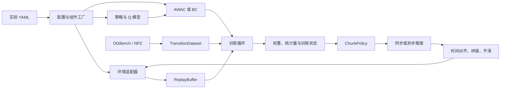

# Robotics 训练框架：接口、数据语义与扩展

本文对应 `src/flow_rl/` 的实际实现。运行命令见仓库根目录的 [README](../../README.md)。

当前基线使用 OGBench `cube-single-play-singletask-task2-v0`、状态 MLP 和 AWAC。策略默认两层 256 单元的 GELU MLP，采用 OGBench 小型状态网络的规模，在本项目中用 PyTorch 实现；不包含 OGBench 预训练权重。单任务环境的 observation 为 28 维，action 为 5 维，控制周期为 0.05 秒，回合上限为 200 步。

## 1. 模块边界



| 模块 | 职责 | 扩展入口 |
| --- | --- | --- |
| `config.py`、`factory.py` | YAML 校验、继承、命令行覆盖和动态构造 | `module:attribute` + `kwargs` |
| `envs/base.py`、`envs/ogbench.py`、`envs/gym.py` | 统一 reset/step 契约和仿真环境构造 | 新环境工厂或 `register_env` |
| `envs/robot.py` | 将设备传输接口与任务 reward/termination 分开 | `RobotTransport`、`RobotEnv` |
| `data/dataset.py`、`data/replay.py` | 离线窗口、在线 replay 和多步回报 | 相同的 `sample(batch_size)` 返回格式 |
| `data/ogbench.py`、`data/io.py`、`data/rollout.py` | 官方数据、显式 transition 文件和随机 smoke 数据 | 独立数据源适配器 |
| `models/base.py`、`models/gaussian.py`、`models/critic.py` | 推理契约、可训练 Gaussian policy 和 Q ensemble | `ChunkPolicy`、`TrainableChunkPolicy`、`WorldModel` |
| `algorithms/awac.py`、`algorithms/bc.py` | 损失、优化器、target 更新和算法状态 | `update`、`state_dict`、`load_state_dict` |
| `training/build.py`、`offline.py`、`online.py`、`engine.py` | 组件构造、数据准备、训练调度 | 算法工厂与运行模式 |
| `training/checkpoints.py`、`metrics.py` | checkpoint 和 JSONL 指标 | 训练循环共用 |
| `inference/controller.py`、`runner.py` | action chunk 的时序管理与推理并发 | runner、controller |
| `inference/stitching.py`、`smoothing.py` | 独立的拼接与平滑策略 | `combine`、`apply`、`reset` |

CLI 只负责解析参数。训练、评估、环境和策略均可从 Python 直接调用。更换组件时通过工厂路径导入，不需要在训练循环中添加供应商判断。

## 2. 环境与数据契约

### 环境接口

环境使用 Gymnasium 语义：

```python
observation, info = env.reset(seed=0, options=None)
next_observation, reward, terminated, truncated, info = env.step(action)
env.close()
```

环境必须提供 `observation_space` 和 `action_space`。`terminated` 表示任务定义的终止，`truncated` 表示时间上限或外部截断。采集时必须保存 step 返回的最终 observation，再执行下一次 reset；不要将下一回合的初始 observation 当作前一回合的 next observation。

通用环境协议允许字典或图像 observation；当前 `training.build.make_env`、`TransitionDataset` 和内置 MLP 训练仅支持一维状态向量及有限上下界的连续动作。后续图像或 VLA 训练需增加对应数据处理、模型和训练逻辑。

### 存储格式与采样格式

`load_npz` / `save_npz` 使用以下六个显式 transition 数组。NPZ 中动作应为环境 action space 的原始单位；训练构造阶段负责归一化。

| 字段 | 形状 | 含义 |
| --- | --- | --- |
| `observations` | `[N, O]` | 执行动作前的状态 |
| `actions` | `[N, A]` | 实际执行的单步动作 |
| `rewards` | `[N]` | 单步 reward |
| `next_observations` | `[N, O]` | 执行动作后的状态 |
| `terminals` | `[N]` | 本 transition 是否为轨迹边界，值为 0 或 1 |
| `masks` | `[N]` | 本 transition 后是否允许 bootstrap，值为 0 或 1 |

`terminals` 与 `masks` 用途不同：

- 普通 transition：`terminals=0, masks=1`。
- 时间上限：`terminals=1, masks=1`，限制 chunk 跨越回合，但保留价值 bootstrap。
- 真正终止：通常为 `terminals=1, masks=0`。
- OGBench 重标注数据：原始轨迹边界仍由 `terminals` 表示；达到固定任务目标时 `masks=0`，原始 play 轨迹可能还会继续，因此此时 `terminals` 可以是 0。

`load_ogbench_dataset` 调用官方 noncompact loader，生成 next observation 并按 singletask 的任务重标注 reward/mask。官方原始 NPZ 还包含轨迹末尾状态等内容，不能直接交给本项目的 `load_npz`。

设 chunk 长度为 H，`TransitionDataset.sample(B)` 和 `ReplayBuffer.sample(B)` 返回：

```text
observations       [B, O]
actions            [B, H, A]
rewards            [B]       # 已聚合的 H 步折扣回报
discounts          [B]       # 已包含 gamma 和 mask
next_observations  [B, O]    # chunk 最后一条 transition 的 next observation
```

只采样完整的、位于同一轨迹中的 H 条 transition。前 H−1 条不能有 `terminals=1`；最后一条可以结束轨迹。短尾部直接排除，不补零或重复动作。`len(dataset)` / `len(replay)` 表示可用窗口数，`.size` 表示 transition 数。显式 `sample(B, indices=...)` 中的索引是 transition 起点，便于调试。

随机采集器只用于检查仿真、训练、checkpoint、推理是否连通。即使随机 smoke 流程成功，也不能说明学会了搬运方块。

### 动作与 observation 归一化

训练和策略内部统一使用 `[-1, 1]` 动作。环境上下界为 l、h 时：

\[
a_{\mathrm{norm}}=\operatorname{clip}\left(2\frac{a-l}{h-l}-1,-1,1\right),\qquad
a=l+\frac{a_{\mathrm{norm}}+1}{2}(h-l).
\]

离线数据进入训练前转换，在线 replay 保存已归一化的实际动作；评估在 `env.step` 前还原到环境单位。controller 也在归一化空间拼接、平滑和裁剪。

开启 `data.normalize_observations` 后，训练数据的均值与标准差会写入 actor 和 critic 的 buffer；标准差计算后至少为 `1e-3`。这些 buffer 随 `state_dict` 保存，加载模型后直接输入原始 observation 即可。纯在线且无离线数据时，使用初始的零均值、单位标准差；当前没有在线更新归一化统计量。

## 3. AWAC、BC 与 chunk 学习

### 单步 AWAC

默认 H=1，策略为带 tanh 变换的对角 Gaussian，输出有界动作；Q ensemble 默认包含两个独立 Q 网络。记 `m_t` 为 mask，target Q 参数为 \(\bar\phi\)：

\[
y_t=r_t+\gamma m_t\min_j Q_{\bar\phi_j}(s_{t+1},a'),
\qquad a'\sim\pi_\theta(\cdot\mid s_{t+1}).
\]

critic 最小化 \(\mathbb E[(Q_{\phi_j}(s_t,a_t)-y_t)^2]\)。actor 使用当前 critic 计算优势：

\[
\widehat V(s)=\frac1K\sum_{k=1}^{K}\min_j Q_{\phi_j}(s,\tilde a_k),
\quad \tilde a_k\sim\pi_\theta(\cdot\mid s),
\]

\[
A(s,a)=\min_j Q_{\phi_j}(s,a)-\widehat V(s),\qquad
w=\min\left(\exp(A/\lambda),w_{\max}\right),
\]

\[
\mathcal L_{\mathrm{actor}}=-\mathbb E[w\log\pi_\theta(a\mid s)].
\]

`temperature` 控制 \(\lambda\)，`num_value_samples` 控制 K，`max_weight` 控制权重上限。优势与权重停止梯度，target 参数按 \(\bar\phi\leftarrow(1-\tau)\bar\phi+\tau\phi\) 更新。当前 AWAC 通过采样 actor 估计 V，没有单独训练 V 网络，也没有 entropy bonus；如算法需要独立 V 模型，应扩展该算法的构造与状态保存。

### H 步 action chunk

H>1 时，将 \(u_t=(a_t,\ldots,a_{t+H-1})\) 作为一个动作序列。actor 输出整段，critic 接收状态与展平后的 H×A 动作。采样器计算：

\[
R_t^{(H)}=\sum_{i=0}^{H-1}\gamma^i
\left(\prod_{j=0}^{i-1}m_{t+j}\right)r_{t+i},
\qquad
D_t^{(H)}=\gamma^H\prod_{i=0}^{H-1}m_{t+i}.
\]

空乘积取 1。如果中途出现 `masks=0`，保留该步 reward，但停止累加后续 reward，并令 bootstrap 折扣为 0。chunk target 为：

\[
y_t=R_t^{(H)}+D_t^{(H)}\min_jQ_{\bar\phi_j}(s_{t+H},u'),
\quad u'\sim\pi_\theta(\cdot\mid s_{t+H}).
\]

算法直接使用 batch 的 `rewards` 和 `discounts`，不会再乘一次 gamma。actor 的 log probability 对全部 H×A 分量求和，因此 AWAC 权重作用于整个序列。H>1 是本项目提供的序列扩展，实验结果应与 H=1 基线分开记录。执行时若重规划、平滑或丢弃迟到动作，实际控制序列可能偏离训练时评分的完整 chunk，需要通过任务评估选择参数。

### 训练模式

| `training.mode` | 算法与数据 | 当前行为 |
| --- | --- | --- |
| `offline_rl` | AWAC + OGBench / NPZ | 只从固定数据更新参数 |
| `supervised` | BC + OGBench / NPZ | 最大化数据动作的似然，不构造 critic |
| `online_rl` | AWAC + 在线 replay，可选离线数据 | 随机 warmup 后采样策略 chunk，依次执行；按 `offline_ratio` 混合数据 |

切换 BC 需要同时修改 mode 与 `algorithm.target`；配置校验会拒绝 supervised 与需要 critic 的算法混用。在线训练记录真正执行的动作和观测 transition。当前在线采集按完整 chunk 顺序执行，评估/部署使用独立的时延 controller；在线采集暂未通过异步推理 runner 调度。

checkpoint 保存配置、actor/critic/target、优化器、更新次数、observation 统计量及离线采样和 Torch RNG 状态。`--resume` 用于离线继续训练，要求模型、算法、环境和数据等配置匹配；`--init-from` 可用于在线微调，会加载训练状态并从新的环境/replay 开始。在线 replay 和真机状态没有序列化，不能宣称精确恢复在线现场。

## 4. 仿真器与真机扩展

### Gymnasium 仿真器

已注册为 Gymnasium 环境的模拟器可直接配置：

```yaml
environment:
  target: flow_rl.envs:make_gym_env
  kwargs:
    env_id: Pendulum-v1
data:
  source: none
training:
  mode: online_rl
```

需要导入插件或包装 observation 时，在自己的模块定义工厂，并将 `environment.target` 指向该函数：

```python
# my_project/sim.py
import gymnasium as gym

def make_simulator(env_id: str, **kwargs):
    # 第三方模拟器需在此导入其实际注册模块。
    return gym.make(env_id, **kwargs)
```

内置 trainer 要求向量 observation；若模拟器返回字典，可在工厂中包装成约定的状态向量。复杂多模态训练应实现自己的输入处理，避免丢失相机或语言信息。

### RobotTransport：设备连接与任务定义分开

下面的 transport 接收应用提供的回调。回调内部使用用户已有 SDK 完成连接、复位、命令发送和读数；代码不假设任何 Franka 或方舟无限 SDK 方法。

```python
# my_project/robot.py
from flow_rl.envs import RobotEnv, RobotTransport
from flow_rl.factory import instantiate

class CallbackTransport(RobotTransport):
    def __init__(self, observation_space, action_space,
                 reset_fn, send_fn, read_fn, close_fn):
        self.observation_space = observation_space
        self.action_space = action_space
        self._reset, self._send = reset_fn, send_fn
        self._read, self._close = read_fn, close_fn

    def reset(self, *, options=None):
        return self._reset(options=options)  # (observation, info)

    def send_action(self, action):
        self._send(action)                  # 环境单位的动作

    def read_observation(self):
        return self._read()                 # (observation, info)

    def close(self):
        self._close()

def make_robot(transport_target: str, task_target: str, max_episode_steps=200):
    transport = instantiate(transport_target)
    try:
        evaluate = instantiate(task_target)
        return RobotEnv(transport, evaluate, max_episode_steps=max_episode_steps)
    except Exception:
        transport.close()
        raise
```

`transport_target` 指向用户编写的无参工厂，返回绑定真实 SDK 回调的 `CallbackTransport`。`task_target` 指向返回任务评估函数的工厂。以下是一个明确约定 observation 前三维为末端 xyz 的示例：

```python
# my_project/tasks.py
import numpy as np

def make_reach_task():
    goal_xyz = np.array([0.4, 0.0, 0.3], dtype=np.float32)

    def evaluate(previous_observation, action, observation):
        distance = float(np.linalg.norm(observation[:3] - goal_xyz))
        success = distance < 0.02
        return -distance, success, {"success": success}

    return evaluate
```

```yaml
environment:
  target: my_project.robot:make_robot
  kwargs:
    transport_target: my_robot_binding:connect_transport
    task_target: my_project.tasks:make_reach_task
    max_episode_steps: 200
```

`my_robot_binding:connect_transport` 是需要用户实现的应用工厂。`RobotEnv` 会在发送前检查动作有限性与 action space 边界；设备驱动仍需负责控制周期、命令有效期、硬件限位及停止行为。目前没有可直接运行的 Franka 或方舟无限驱动。

## 5. 接入 VLA 与世界模型

### 仅推理：实现 ChunkPolicy

`ChunkPolicy.predict(observation)` 的输入可以是状态数组，或包含图像、状态、语言的 mapping；返回值必须是有限的 NumPy 数组 `[H, A]`，范围为 `[-1, 1]`。mapping 支持指的是 observation 输入，动作输出仍为数组。

以下包装器接收用户提供的推理函数。该函数可以调用本地模型或远程服务，并返回与环境相同单位的动作；包装器负责转换到统一动作空间：

```python
# my_project/vla.py
import numpy as np
from flow_rl.models.base import ChunkPolicy

class VLAChunkAdapter(ChunkPolicy):
    def __init__(self, infer_fn, action_low, action_high, chunk_size):
        self.infer_fn = infer_fn
        self.low = np.asarray(action_low, dtype=np.float32)
        self.high = np.asarray(action_high, dtype=np.float32)
        self.chunk_size = chunk_size
        if not np.all(np.isfinite(self.low) & np.isfinite(self.high)
                      & (self.low < self.high)):
            raise ValueError("动作边界必须有限且 high > low")

    def predict(self, observation):
        # 数据键由本应用定义；infer_fn 负责模型对应的图像和文本处理。
        payload = {"images": observation["images"],
                   "state": observation["state"],
                   "instruction": observation["instruction"]}
        actions = np.asarray(self.infer_fn(payload), dtype=np.float32)
        if actions.shape != (self.chunk_size, len(self.low)):
            raise ValueError("VLA 必须返回 [chunk_size, action_dim]")
        if not np.all(np.isfinite(actions)):
            raise ValueError("VLA 返回了非有限动作")
        return np.clip(2 * (actions - self.low) / (self.high - self.low) - 1, -1, 1)
```

将实例交给 `flow_rl.evaluation.make_runner(policy, config, action_dim)` 即可复用时延、拼接和平滑。循环中调用 `runner.act(observation)`，再还原动作单位后 `env.step`。这条直接 Python 推理路径可以传入字典 observation；当前基于 checkpoint 的 CLI 和内置模型构造仍面向可训练状态 MLP。

PI0.5 等 VLA 模型本体、权重、服务客户端、训练和数据转换尚未实现。上面的 `infer_fn` 是明确的接入位置。只实现 `predict` 的远程服务不能直接参加 AWAC/BC 梯度训练；可训练策略还必须提供 `sample`、`log_prob`、参数和状态接口，并满足 PyTorch 构造流程。

### 世界模型接口

`WorldModel` 在 `models/base.py` 定义：

```python
import numpy as np
from flow_rl.models.base import Observation

def rollout(observation, actions: np.ndarray) -> list[Observation]:
    ...
```

输入动作仍为 `[H, A]`；应用需明确每个返回 observation 与动作步的对应关系。一个已有世界模型可以通过回调包装：

```python
from flow_rl.models.base import WorldModel

class CallableWorldModel(WorldModel):
    def __init__(self, rollout_fn):
        self.rollout_fn = rollout_fn

    def rollout(self, observation, actions):
        return self.rollout_fn(observation, actions)
```

当前只提供接口；没有世界模型实现、训练循环、想象数据采样或 MPC planner。若使用模型进行规划，应另外实现输出 `ChunkPolicy` 的规划器，再接入同一个 inference runner。

## 6. 推理时序、拼接和平滑

### 两种时间基准

- `realtime: false`：仿真逻辑时间。同步推理期间环境暂停，不按墙钟计算 chunk 过期；适合可复现的算法评估。
- `realtime: true`：使用单调时钟计算真实时延。评估循环按控制周期等待；runner 本身不 sleep，直接接真机时应由控制循环调度。

同步 runner 阻塞等待预测；异步 runner 用一个后台 worker 预测，同时执行已有 chunk。reset 后不会将上一回合完成的预测提交到新回合。模型调用异常会传回控制循环。

设请求时间为 \(t_q\)，结果可用时间为 \(t_r\)，控制周期为 \(\Delta t\)：

\[
k=\left\lceil\frac{t_r-t_q}{\Delta t}\right\rceil.
\]

controller 丢弃最前面的 k 个动作。如果 k≥H，整段作废。后续动作索引继续按请求时间对齐；所有时间戳必须来自同一时钟。OGBench cube 的周期是 `control_dt: 0.05`。例如 H=8、耗时 70 ms 时，跳过 2 个动作，剩余 6 个动作；需为后续请求、网络抖动和调度保留余量。

实际部署至少需要 H 大于时延消耗的步数；H=1 的默认单步基线不适合开启真实时延丢弃后直接执行。`refresh_steps` 决定重新请求的间隔，不能超过 H。若预测耗时或刷新周期接近整个 horizon，fallback 会频繁触发。异步模式下日志里的 `control_call_ms_*` 是控制循环调用耗时，不代表模型推理本身耗时。

### 内置策略

| 配置 | 行为 |
| --- | --- |
| `stitching: replace` | 使用最新可用预测，释放旧 chunk |
| `stitching: ensemble` | 对同一控制时刻的重叠预测按年龄指数加权，`ensemble_decay` 越大越偏重新预测 |
| `smoothing: none` | 直接输出拼接结果 |
| `smoothing: ema` | `alpha * 当前动作 + (1-alpha) * 上次输出`，由 `ema_alpha` 控制 |
| `fallback: hold` | 没有可用预测时保持最近动作 |
| `fallback: zeros` | 没有可用预测时输出裁剪到边界内的零动作，并清空平滑历史 |

`hold` 和 `zeros` 是通用动作空间策略，它们是否代表设备停稳取决于动作定义。当前 controller 不提供硬件 watchdog 或硬实时保证，真机驱动应单独处理命令超时与停止。

### 自定义策略：无参工厂

`evaluation.make_runner` 识别配置中的 `module:attribute`，并以无参方式构造策略。需要参数时，可以让该路径指向一个预设参数的工厂；目前 inference 配置没有通用的策略 kwargs 字段。

```python
# my_project/strategies.py
import numpy as np
from flow_rl.inference.smoothing import EMASmoother

class MeanStitcher:
    retain_history = True

    def combine(self, actions, ages):
        # actions: [候选 chunk 数, A]，按请求时间从旧到新排列。
        # ages: 每个候选自请求以来经过的控制帧数。
        return actions.mean(axis=0).astype(np.float32)

def make_smoother():
    return EMASmoother(alpha=0.8)
```

```yaml
model:
  chunk_size: 8
inference:
  stitching: my_project.strategies:MeanStitcher
  smoothing: my_project.strategies:make_smoother
  control_dt: 0.05
  asynchronous: true
  realtime: true
```

平滑类需要 `apply(action)` 与 `reset()`；拼接类需要 `combine(actions, ages)`。两者均返回有限的 `[A]` 数组。直接构造 `ChunkController` 时也可以传入策略对象。

## 7. 修改与验证约定

新增算法只依赖标准 batch 契约，避免读取数据文件或直接控制环境。新增模型避免自行管理数据下载与实验路径。新增设备驱动保持 vendor SDK 依赖位于适配器文件内，使 CPU 仿真和单元测试无需安装真机 SDK。

测试按职责划分：`test_data.py` 检查窗口、mask、回报和 replay 环绕；`test_algorithms.py` 检查 AWAC/BC 数学行为；`test_inference.py` 检查时延、过期、拼接与异步状态；`test_training.py` 检查完整训练、checkpoint、恢复和模式切换；`test_envs.py` 的 `integration` 测试使用真实 OGBench/MuJoCo。当前 macOS Codex sandbox 可能阻止 MuJoCo 的系统服务初始化，实际仿真检查需在有相应权限的终端中运行。
